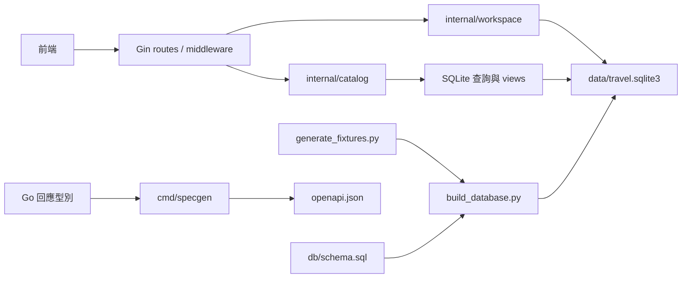

# 模組與資料流

所有業務資料、導覽設定、首頁配置與圖片都存放在 `data/travel.sqlite3`。服務以 `DB_PATH` 指定資料庫，預設讀取專案內的檔案。

## 模組責任

| 模組 | 責任 |
| --- | --- |
| `cmd/server` | 環境設定、開啟資料庫、HTTP 逾時與優雅關閉 |
| `internal/catalog/database.go` | SQLite 連線、參數綁定、SQL 查詢、結果解碼與關閉 |
| `internal/catalog/catalog.go` | 搜尋條件、日期容量、庫存及價格計算 |
| `internal/catalog/model.go` | 商品卡片、品類詳情、方案與內容的回應型別 |
| `internal/httpapi` | Gin 路由、middleware、JSON binding、分頁、聚合與錯誤回應 |
| `internal/workspace` | 寫入 transaction、schema migration、版本與 idempotency 記錄 |
| `internal/assets` | API Explorer 與 OpenAPI 契約 |
| `db/schema.sql` | 資料表、外鍵、索引及資料約束 |
| `scripts/build_database.py` | 匯入假資料與圖片，建立查詢 views，檢查完整性後輸出資料庫 |
| `scripts/database_manifest.py` | 產生與 SQLite 二進位標頭無關的邏輯快照 |

## 查詢方式

商品搜尋在 SQLite 執行文字比對、品類、目的地、價格、評分、設施、港口、天數及座標篩選與排序。結果再由 Go 計算 facets、檢查日期容量及分頁。

完整商品由 `product_details` view 組合品類詳情、方案、行程與評價。卡片起價來自最低價方案，評分來自評價資料；兩者沒有另外存放一份需要同步的摘要。

首頁與目的地頁分別查詢所需資料並聚合。`settings` 保存導覽、前端設定與首頁配置。`media` 保存圖片的 MIME type 及 BLOB，`/images/` 直接查詢這張表。

SQL 查詢使用 request context 與綁定參數。HTTP handler 不保留啟動時的資料快照；在同一檔案上提交的 SQLite 更新會被後續請求讀取。

## 儲存設計

採用一個外部 SQLite 檔案及關聯資料表。商品、目的地、方案、內容與關聯使用獨立資料表；有順序的簡單文字清單及圖片描述使用 JSON 欄位。所有圖片位元組仍保存在同一個資料庫。

另一個可行方案是在啟動時將資料庫全部載入記憶體，但它需要重新啟動才會反映資料變更。此處選擇每次請求查詢 SQLite，讓資料庫成為直接的回應來源。

商品查詢連線使用 `mode=ro`，workspace 寫入連線使用 `mode=rw`；缺少資料庫時會啟動失敗。資料庫錯誤回傳 500，資源不存在回傳 404。資料庫使用 DELETE journal mode，正常關閉交易後只保留主資料庫檔。

## 資料產生與驗證

`make generate` 會從固定假資料重建 SQLite 與 OpenAPI。建庫程式先產生暫存檔，通過 integrity 與 foreign key 檢查後才替換目標檔案。生成時應先停止使用該檔案的服務，完成後再啟動。

CI 比對資料表、資料列與 views 的邏輯快照，避免不同 SQLite 版本的檔案標頭造成誤判。API 測試另以暫存資料庫驗證：修改商品、價格、評價、導覽與圖片後，既有服務會立即回傳新內容。

日期庫存由資料庫提供的方案 ID 及日期依固定規則推導，報價使用資料庫中的方案價格與容量。庫存不是訂單庫存，也不會在查詢時扣除。

## Gin 與寫入流程

Gin Engine 註冊 GET、HEAD、POST 與 PUT 路由。既有查詢 handler 直接接收 `*gin.Context`，使用相同 catalog 查詢與回應型別。

寫入流程為 middleware → JSON binding → 日期與欄位關係驗證 → workspace transaction → SQLite → response envelope。HTTP request structs 的 binding tags 定義必填、字串長度、數值範圍、日期格式與巢狀 items 驗證，OpenAPI request schema 從相同 tags 產生。

收藏及行程存為具版本的 documents，內容依資源型別驗證；商品關聯另存 document_products，透過外鍵維護。managed_reviews 保存新評價的編輯版本，原本 reviews 資料表及投影繼續提供公開評價與評分。

POST 將業務資料和 idempotency response data 寫在同一個 transaction，失敗一起 rollback。PUT 在 transaction 內比較版本與內容，阻止較舊的不同內容覆寫。SQLite 使用 immediate transaction，跨程序的寫入鎖由資料庫協調，單一程序的 writer pool 限制為一條連線。

讀取與寫入使用同一個 SQLite 檔案、分開的 connection pool。catalog 保留唯讀權限，workspace 擁有寫入及 migration。另一種設計是共用可寫的 pool，會讓所有查詢模組都取得修改權限；目前選擇以 pool 區分責任。

Middleware 負責 request ID、結構化 access log、panic recovery、CORS、body limit、workspace key 及寫入限流。API_WRITE_KEY 未設定時保留公開查詢與 JSON 報價；workspace 路由回傳 503。key 設定時先執行 idempotent migration，再接受請求。

Swagger UI 使用嵌入的 docs.html 與 OpenAPI 契約，UI 的 JavaScript 和 CSS 由 CDN 載入。API Explorer 保留在根路徑。
