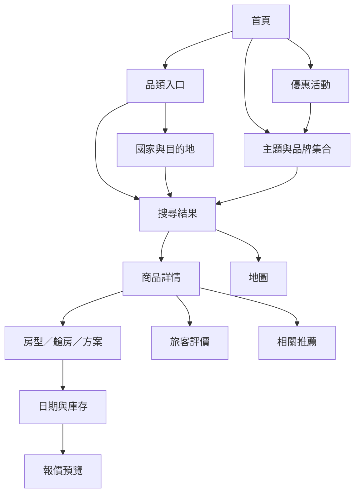

# 資訊架構與頁面資料需求

觀察日期：2026-10-20，Asia/Taipei。以公開網頁的可見導覽、頁面內容及瀏覽器 resource timing 中的請求為依據。研究過程沒有登入、送出預訂或存取個人資料。

## 全站以品類入口串接目的地與商品

網站首頁已是多品類旅遊入口。主導覽將住宿、郵輪、跟團、景點體驗、交通及運動旅遊分開；首頁再以優惠、主題及品牌集合交叉導流。

前端最重要的資料主軸是「探索 → 縮小範圍 → 評估商品 → 選日期與方案」。商品種類雖多，清單卡片的名稱、位置、圖片、起價、評分與標籤仍可共用。

## 各畫面的資料需求

| 畫面 | 本次觀察 | 對應的 mock 資料 |
| --- | --- | --- |
| 全站框架 | 品類導覽、語系、幣別、會員入口、支援及頁尾 | config、navigation |
| 首頁 | 搜尋入口、品類捷徑、優惠輪播、多組主題卡片、內容與支援入口 | home、categories、campaigns、collections、articles、faqs |
| 住宿入口 | 依國家分組的目的地，以及露營、包棟和品牌專區 | destinations、collections |
| 住宿結果 | 麵包屑、目的地、起訖日期、人數、房數、排序、標籤、篩選與地圖 | products、search/filters、products/map |
| 住宿詳情 | 圖庫、位置、附近資訊、房型、設施、入住說明及取消政策 | products/{id}、rooms、availability、reviews |
| 郵輪入口 | 港口與日期搜尋、優惠、航區主題、船公司及航程推薦 | cruise/regions、campaigns、collections、products |
| 郵輪詳情 | 出發日列表與月曆、每日停靠、船舶介紹、艙房、費用、評價及須知 | departures、calendar、itinerary、cabins、availability、reviews |
| 跟團結果 | 目的區域、出發地、日期窗、成團狀態、天數、價格及多個出發日 | products、departures |
| 體驗及包車詳情 | 方案、日期、行程、集合地點、費用、使用流程及提醒 | products/{id}、plans、calendar、availability |
| 主題及優惠頁 | 主題說明、分頁籤、商品集合與優惠條件 | collections/{id}、collections/{id}/products、campaigns/{id} |

「附近地標」及實站會員專屬功能未獨立實作；位置使用商品經緯度與虛構地址。露營與包棟保留在住宿 `property_type`，也提供集合入口。滑雪及賽事歸入 `sport`。高鐵畫面需求以 `rail` 商品模擬，未模擬真實車次查詢。

## 頁面範圍與 API 分工

1. 繁中首頁：品類、優惠與主題集合的全站入口。
2. 住宿入口：國家與城市分組。
3. 住宿搜尋結果：日期、人數、房數、排序、地圖及卡片資訊。
4. 住宿詳情：房型、設施及政策區塊。
5. 郵輪入口：港口、航區、品牌與優惠。
6. 郵輪詳情：月曆、逐日行程、艙房及評價。
7. 跟團結果：出發日期窗、成團狀態及行程卡片。
8. 體驗與包車詳情：方案、集合地點及使用說明。

`/api/v1/cruise/regions` 提供郵輪港口、航區與品牌，優惠由 `/api/v1/campaigns` 提供。各端點使用 snake_case 欄位及 `{data, meta}` 包裝，依頁面資料需求定義獨立契約。

## 範圍與限制

這是資訊架構及前端資料需求分析，不是完整 UX 或無障礙稽核。會員登入、收藏、訂單、付款、客服送件、真實票價與即時庫存不在本次 GET API 範圍。eSIM、運動及鐵道保留可供前端展示的通用方案模型，沒有完整重建每個原站垂直品類的交易流程。

沒有複製原站商品名稱、長篇文案、旅客評價或照片。商品品牌與優惠另行虛構；圖片使用隨服務提供的幾何 SVG 插畫。
