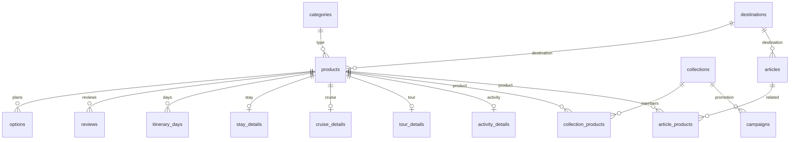

# SQLite 資料庫參考

資料檔：`data/travel.sqlite3`。Schema：`db/schema.sql`。服務使用 `modernc.org/sqlite` 驅動，不需要 CGO 或系統 SQLite 動態函式庫。

## 資料表

| 資料表 | 內容 |
| --- | --- |
| `categories` | 商品品類 |
| `destinations` | 目的地、國家、座標及圖片描述 |
| `products` | 商品基本資料、標籤、設施、圖庫及政策 |
| `options` | 房型、艙房及方案的價格、容量與圖片描述 |
| `stay_details` | 住宿類型與入住退房時間 |
| `cruise_details` | 船名、船公司、出發港與航線 |
| `tour_details` | 出發地、交通及成團門檻 |
| `activity_details` | 集合地點、憑證與使用步驟 |
| `itinerary_days` | 郵輪與跟團每日行程 |
| `reviews` | 商品評價 |
| `collections` | 主題集合 |
| `collection_products` | 集合內商品與顯示順序 |
| `campaigns` | 優惠活動及集合關聯 |
| `articles` | 文章與段落 |
| `article_products` | 文章相關商品與順序 |
| `faqs` | 常見問題 |
| `settings` | 導覽、前端設定與首頁配置 |
| `media` | 圖片 MIME type 與二進位內容 |
| `documents` | 收藏與行程的內容、版本及時間 |
| `document_products` | 收藏及行程的商品外鍵關聯 |
| `managed_reviews` | API 建立的評價與編輯版本 |
| `idempotency_keys` | POST 正規化 request hash 與已提交 response data |



## 查詢與編輯

```sh
sqlite3 data/travel.sqlite3 '.tables'
sqlite3 data/travel.sqlite3 'PRAGMA integrity_check; PRAGMA foreign_key_check;'
sqlite3 data/travel.sqlite3 'SELECT id, type, title FROM products LIMIT 5;'
sqlite3 data/travel.sqlite3 'SELECT id, amount, capacity FROM options WHERE product_id="stay-001";'
```

在同一個檔案內更新資料後，後續 API 請求會讀取新值：

```sh
sqlite3 data/travel.sqlite3 <<'SQL'
PRAGMA foreign_keys = ON;
BEGIN;
UPDATE products SET title = '新的旅宿名稱' WHERE id = 'stay-001';
UPDATE options SET amount = 2500 WHERE id = 'stay-001-opt-1';
COMMIT;
SQL
curl 'http://localhost:8080/api/v1/products/stay-001'
```

`product_cards`、`product_details` 及各個 `*_json` views 組合 API 投影。修改底層資料表即可，views 本身不儲存另一份資料。

圖片位址保存在各筆資料的圖片描述中，實際內容由 `media.url` 對應。若新增圖片，將位元組寫入 `media.content`，並填寫 MIME type。

## 重建資料庫

```sh
python3 scripts/generate_fixtures.py
```

這個命令會覆寫目標資料庫，還原生成程式定義的內容。先停止服務，重建後再啟動；執行中的 SQLite 連線可能仍持有被替換檔案的舊 handle。

完整生成指令：

```sh
make generate
```

輸出邏輯快照以比對不同環境的資料：

```sh
python3 scripts/database_manifest.py > /tmp/travel-catalog.json
```

## Schema migration 與寫入

新資料庫的 `PRAGMA user_version` 為 2。`internal/workspace/migration.sql` 為 v1 → v2 migration，由 Go embed 及資料生成程式共用。啟用 API_WRITE_KEY 時服務以 transaction 套用 migration；版本 2 重新啟動不會重建資料表或清空資料。catalog 查詢仍可開啟版本 1 與版本 2。

資料檔與所在目錄都需要寫入權限，SQLite 使用 DELETE journal，transaction 期間可能產生暫時 journal，完成後只保留主要 sqlite3 檔案。Docker 掛載整個 /app/data 目錄即可保存寫入。

`make generate` 會還原種子資料，也會清除新增的收藏、行程、評價及 idempotency 記錄。執行前先備份需要保留的資料。
